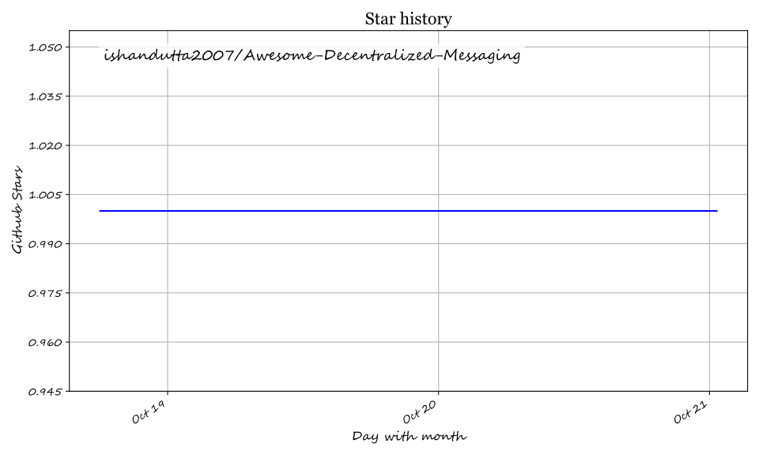

# Awesome Decentralized Messaging 🌐

  

  
  
  
  
  
  

---

## ⚡ Top Decentralized Messaging Ecosystem

**A Curated List of SaaS Collaboration Platforms, Federated Protocols & Open-Source Peer-to-Peer Projects**  
*Focused on End-to-End Encryption (E2EE), Metadata Minimization, Censorship Resistance & Digital Sovereignty.*

> **Last updated: October 2026**

This repository tracks notable enterprise **SaaS platforms** and **open-source projects** in the **Decentralized Messaging** ecosystem. These technologies enable modern, real-time communication without reliance on a single central provider or surveillance monoculture—spanning federated servers, relay-based architectures, and serverless P2P mesh topologies designed to eliminate identity leakage and metadata harvesting.

---

## 📑 Table of Contents
- [📊 Sector Overview & Market Dynamics](#-sector-overview--market-dynamics)
- [🏢 SaaS / Hosted Platforms](#-saas--hosted-platforms)
- [🔓 Open-Source GitHub Projects](#-open-source-github-projects)
- [🛠️ Architectural Trade-Offs & Stacks](#️-architectural-trade-offs--stacks)
- [🤝 How to Contribute](#-how-to-contribute)
- [⚠️ Disclaimer & Threat Models](#️-disclaimer--threat-models)
- [💖 Support & Sponsorship](#-support--sponsorship)
- [📈 Star History](#-star-history)

---

## 📊 Sector Overview & Market Dynamics

The enterprise messaging and collaborative communication market is estimated at **$45.2 billion in 2026** (projected to exceed $85 billion by 2031 at a ~13.5% CAGR). 

The hosted communication sector remains **highly concentrated and winner-take-most**, dominated by tech conglomerates (Microsoft Teams, Cisco, Salesforce Slack) that capture over 70% of enterprise seats through bundled productivity suites. However, privacy mandates, cross-border data sovereignty regulations (such as EU NIS2 and GDPR), and recurring cloud surveillance concerns have catalyzed rapid growth in a **vibrant, fragmented open-source and federated alternative ecosystem** (spanning Matrix, SimpleX, Nostr, and serverless P2P protocols).

---

## 🏢 SaaS / Hosted Platforms

The table below contrasts mainstream hosted and centralized platforms against enterprise privacy and sovereignty requirements. Platforms are ordered by company size (valuation / market capitalization, descending).

| Product | Company Valuation / Revenue | Pricing (Starting Tier) | Free Tier / Trial Limits | Decentralization & Privacy Architecture | Target Use Case |
| :--- | :--- | :--- | :--- | :--- | :--- |
| **[Microsoft Teams](https://www.microsoft.com/en-us/microsoft-teams)** | **$3.1 Trillion** (Market Cap) / ~$245B Ann. Revenue | **$4.00/user/month** (Microsoft Teams Essentials, annual commitment) | **Free tier forever**: 60-min group meeting limit, up to 100 participants per meeting, and 5 GB cloud storage per user. | Proprietary central cloud. No federation or self-hosting; data retained under Microsoft enterprise policy. | Enterprises standardized on Microsoft 365. |
| **[Slack](https://slack.com/)** *(Salesforce)* | **$280 Billion** (Salesforce Market Cap; acquired Slack for $27.7B) | **$7.25/user/month** (Pro plan, billed annually) | **Free tier forever**: 90 days of searchable message and file history, 10 app integrations, 1:1 audio/video huddles. | Fully centralized cloud; complete metadata and message index visibility to platform operator. | Fast-paced startups and corporate teams prioritizing tool integrations. |
| **[Cisco Webex](https://www.webex.com/)** | **$225 Billion** (Cisco Systems Market Cap) / ~$54B Ann. Revenue | **$12.00/license/month** (Webex Meet Plan, billed annually) | **Free tier forever**: 40-min meeting limit, up to 100 attendees, local recording only, 1 GB Webex cloud storage. | Centralized cloud infrastructure; enterprise administrative access to keys and logs. | Large enterprises with existing Cisco IP telephony and conference room hardware. |
| **[Telegram Business](https://telegram.org/)** | **$30 Billion** (Estimated Valuation) / ~$1B+ Revenue | **$4.99/month** (Telegram Premium / Business subscription) | **Free tier forever**: Unlimited 1-on-1 and group chats (up to 200,000 members), 2 GB file sharing cap, cloud backup. | Centralized MTProto servers. Default chats are **not E2EE** (server holds keys); Secret Chats are device-bound 1:1 only. | High-volume public broadcast communities and consumer messaging. |
| **[Discord](https://discord.com/)** | **$15 Billion** (Private Valuation) / ~$600M Ann. Revenue | **$2.99/month** (Nitro Basic) or **$9.99/month** (Nitro Standard) | **Free tier forever**: 25 MB file upload limit, up to 25 video participants in channels, unlimited message history. | Proprietary centralized servers. No E2EE for standard channels; voice and message data stored unencrypted on central servers. | Gaming guilds, developer communities, and consumer interest groups. |

---

## 🔓 Open-Source GitHub Projects

Discover the leading self-hosted, federated, and peer-to-peer messaging platforms. Each project includes real-time stargazers badges linking directly to their GitHub stargazers page, ordered by Stars_Count (descending).

| Project & Repository | GitHub_Stars | Architecture & Topology | License | Key Privacy & Metadata Highlights |
| :--- | :---: | :--- | :--- | :--- |
| **[Rocket.Chat](https://github.com/RocketChat/Rocket.Chat)** |  | Self-Hosted / Federated Bridges | MIT | Enterprise team hub with omnichannel routing, end-to-end encryption support, and Matrix federation bridge. |
| **[Mattermost](https://github.com/mattermost/mattermost)** |  | Self-Hosted (Single-Tenant) | MIT / Commercial | Slack alternative for mission-critical developer and SecOps teams with on-premise governance and compliance playbooks. |
| **[ntfy](https://github.com/binwiederhier/ntfy)** |  | Self-Hosted HTTP Pub-Sub | Apache-2.0 | Lightweight pub-sub notification service over HTTP/WebSocket without dependence on Google FCM or Apple APNs. |
| **[Jitsi Meet](https://github.com/jitsi/jitsi-meet)** |  | WebRTC / Self-Hosted SFU | Apache-2.0 | 100% open-source video conferencing server with WebRTC end-to-end encryption and room ephemeral tokens. |
| **[SimpleX Chat](https://github.com/simplex-chat/simplex-chat)** |  | Relay Queues (No User IDs) | AGPL-3.0 | Radical metadata minimization: zero user IDs, isolated unidirectional queues, double-ratchet E2EE audited by Trail of Bits. |
| **[Element Web](https://github.com/element-hq/element-web)** |  | Federated (Matrix Protocol) | AGPL-3.0 | The flagship Matrix web/desktop client for decentralized collaboration, voice rooms, and cross-server federation. |
| **[Tinode](https://github.com/tinode/chat)** |  | Self-Hosted / gRPC & WebSocket | GPL-3.0 | Instant messaging server written in Go, customizable as a scalable WhatsApp/Telegram alternative for apps. |
| **[Nostr Protocol](https://github.com/nostr-protocol/nostr)** |  | Decentralized Relay Mesh | Public Domain | Minimalist, censorship-resistant decentralized relay protocol based on cryptographic keypairs and JSON events. |
| **[Berty](https://github.com/berty/berty)** |  | Peer-to-Peer (BLE / mDNS / IPFS) | Apache-2.0 | Offline-first, secure P2P messaging protocol communicating over Bluetooth Low Energy and local mesh without internet access. |
| **[Meshtastic Firmware](https://github.com/meshtastic/firmware)** |  | Off-Grid LoRa Radio Mesh | GPL-3.0 | Firmware enabling long-range, off-grid encrypted communication using inexpensive LoRa radio hardware. |
| **[Matrix Synapse](https://github.com/element-hq/synapse)** |  | Federated Server Reference | AGPL-3.0 | The primary reference server implementation for Matrix homeservers, written in Python/Twisted/Rust. |
| **[Quiet](https://github.com/TryQuiet/quiet)** |  | P2P over Tor Onion Services | GPL-3.0 | Team chat alternative without servers or phone numbers; operates direct P2P connections synced over Tor. |
| **[Session Desktop](https://github.com/oxen-io/session-desktop)** |  | Onion-Routed Decentralized Relays | GPL-3.0 | Private messenger operating over a decentralized node network with onion-routing to obscure client IP addresses. |
| **[Wire Web](https://github.com/wireapp/wire-webapp)** |  | Self-Hosted / Cloud E2EE | AGPL-3.0 | Open-source enterprise collaboration suite with Proteus E2EE protocol and strict European compliance posture. |
| **[Threema Web](https://github.com/threema-ch/threema-web)** |  | Client-Side Open-Source Web App | AGPL-3.0 | Web interface pairing with privacy-first Threema mobile clients via cryptographic session channels. |
| **[Delta Chat Core](https://github.com/deltachat/deltachat-core-rust)** |  | Federated over Standard Email (IMAP/SMTP) | GPL-3.0 | Turns standard email inboxes into instant messaging with automatic Autocrypt end-to-end encryption. |
| **[nostr-tools](https://github.com/nbd-wtf/nostr-tools)** |  | Developer Toolkit / Protocol Library | MIT | The premier TypeScript/JavaScript toolkit for creating clients and bots on the decentralized Nostr protocol. |
| **[Briar](https://github.com/briar/briar)** |  | Serverless P2P / Tor & Mesh | GPL-3.0 | Anti-censorship communications suite utilizing Tor onion routing, local Wi-Fi, and Bluetooth mesh when internet access is severed. |
| **[Jami Client](https://github.com/savoirfairelinux/jami-client-qt)** |  | Distributed Hash Table (OpenDHT) | GPL-3.0 | GNU universal communication client delivering serverless voice, video, text, and screen sharing via distributed hash tables. |

---

## 🛠️ Architectural Trade-Offs & Stacks

Building a production-ready communication system involves balancing three key vectors: **usability**, **sovereignty**, and **metadata security**.

| Topology Pattern | Prominent Implementations | Core Benefits | Primary Trade-Offs |
| :--- | :--- | :--- | :--- |
| **Federated Networks** | Matrix, Synapse, Element | Global discoverability, single identifier across servers, seamless room syncing. | Room participation, traffic timestamps, and homeserver identity graph are visible to server operators. |
| **No-Identity Relays** | SimpleX Chat | Zero global IDs or phone numbers; routing nodes cannot correlate sender and receiver. | Requires out-of-band contact exchange (QR codes or one-time invite links). |
| **Onion-Routed Nodes** | Session, Quiet, Briar | Masks IP addresses from recipients, relays, and intermediate ISPs. | Higher latency, offline storage constraints, and node network maintenance overhead. |
| **Local Mesh & Radio** | Berty, Meshtastic, Briar | Operates completely disconnected from the internet via BLE, Wi-Fi Direct, or LoRa. | Limited data bandwidth (text/telemetry only on LoRa) and spatial proximity boundaries. |
| **On-Premise Hubs** | Mattermost, Rocket.Chat | Enterprise compliance, full organizational ownership, frictionless Slack-like UX. | Single-organization perimeter without decentralized federation across sovereign parties by default. |

---

## 🤝 How to Contribute

Contributions to this curated catalog are warmly welcome!

1. 🍴 **Fork** the repository.
2. 🌿 **Create a branch** for your updates (`git checkout -b feature/add-new-tool`).
3. 📝 **Add entries** following the tabular format and GitHub Stars_Badge conventions.
4. 🚀 **Submit a Pull Request** with a concise description of the tool's encryption and metadata architecture.

Please ensure added projects are open source or clearly labeled SaaS, actively maintained, and verified against verifiable cryptographic standards.

---

## ⚠️ Disclaimer & Threat Models

- This repository is a community-curated technical resource—not financial or legal endorsement.
- **Threat Model Differentiation**: Encrypting message payloads (E2EE) does not automatically shield your social graph. If your threat model demands protection against state-level surveillance or social-graph mapping, prioritize **no-identity relay** or **onion-routed** architectures over standard federated hubs.
- **Auditing Matters**: Always verify external independent audit reports (such as Trail of Bits, Cure53, or Quarkslab) before rolling out systems in high-risk human rights or classified environments.

---

## 💖 Support & Sponsorship

If you find this decentralized messaging ecosystem guide helpful for your research, team, or privacy architecture:

- ⭐ **Star** this repository to help other developers and privacy engineers discover it!
- 🍴 **Fork** and share it with your community, security engineers, and DevOps circles.
- ☕ **Support the maintainer**: You can buy a coffee or sponsor ongoing maintenance directly on the [GitHub Sponsors Dashboard](https://github.com/sponsors/ishandutta2007).

Your encouragement and support help keep this list comprehensive, independent, and up to date! ✨

---

## 📈 Star History

---

  Curated with care by <a href="https://github.com/ishandutta2007">Ishan Dutta</a> and the global open-source decentralized privacy community.

## ⭐ Star History

<a href="https://star-history.com/#ishandutta2007/Awesome-Decentralized-Messaging&Timeline" align="center">
  <picture>
    <source media="(prefers-color-scheme: dark)" srcset="assets/ishandutta2007_Awesome-Decentralized-Messaging_growth.svg">
    
  </picture>
</a>
